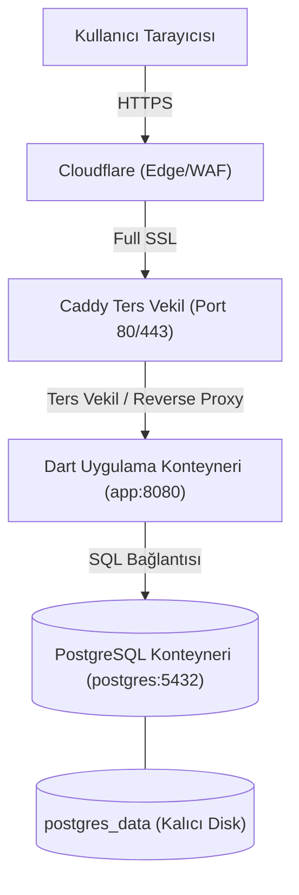
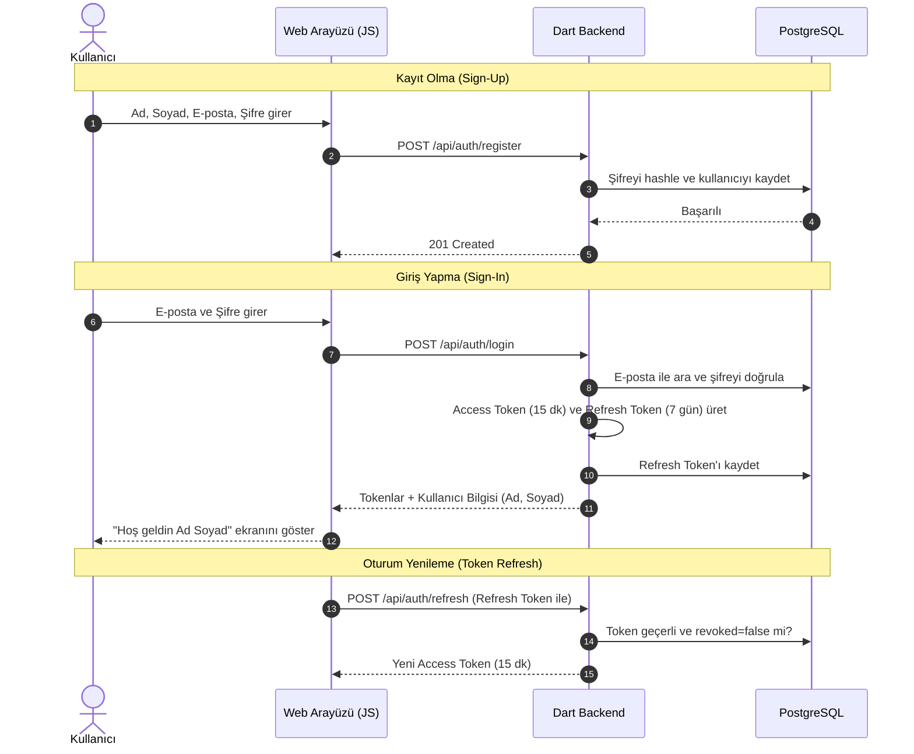

# Dart + PostgreSQL + JWT Kimlik Doğrulama Sistemi Mimari Planı

Bu belge, mevcut Dart backend uygulamasını **JWT (JSON Web Token)** tabanlı kimlik doğrulama, kullanıcı kayıt/giriş sayfaları, karşılama ekranı ve kalıcı **PostgreSQL** veritabanı entegrasyonu ile modernize etme planını ayrıntılarıyla sunmaktadır.

---

## 1. Mimari Genel Bakış

Sistem 3 temel Docker konteynerinden oluşacaktır:
1. **`caddy`**: Dış dünyadan (Cloudflare üzerinden) gelen istekleri karşılayan, HTTPS sonlandıran ters vekil.
2. **`app`**: Dart ile yazılmış REST API ve modern Web Arayüzünü sunan uygulama sunucusu (Port: `8080`).
3. **`postgres` (Yeni)**: Kullanıcı hesapları ve refresh token kayıtlarını saklayan ilişkisel veritabanı (Port: `5432` - Sadece iç ağ).

---

## 2. Veritabanı Tasarımı (PostgreSQL)

Veritabanı otomatik olarak oluşturulacak iki ana tablodan oluşacaktır. Dart uygulaması ilk açıldığında tablolar yoksa `CREATE TABLE IF NOT EXISTS` ile şemayı otomatik hazırlayacaktır.

### A. `users` Tablosu
Kullanıcı kimlik ve profil bilgilerini tutar:
* `id`: SERIAL PRIMARY KEY (Benzersiz kullanıcı ID)
* `first_name`: VARCHAR(100) NOT NULL (Ad)
* `last_name`: VARCHAR(100) NOT NULL (Soyad)
* `email`: VARCHAR(255) UNIQUE NOT NULL (Giriş için e-posta)
* `password_hash`: VARCHAR(255) NOT NULL (Tuzlanmış/Salted güvenli parola özeti)
* `created_at`: TIMESTAMPTZ DEFAULT CURRENT_TIMESTAMP

### B. `refresh_tokens` Tablosu
JWT yenileme anahtarlarını ve oturum durumunu takip eder:
* `id`: SERIAL PRIMARY KEY
* `user_id`: INT REFERENCES users(id) ON DELETE CASCADE
* `token`: TEXT UNIQUE NOT NULL (Rastgele üretilmiş kriptografik token)
* `expires_at`: TIMESTAMPTZ NOT NULL (Örn: 7 günlük geçerlilik)
* `revoked`: BOOLEAN DEFAULT FALSE (Çıkış yapıldığında iptal için)
* `created_at`: TIMESTAMPTZ DEFAULT CURRENT_TIMESTAMP

---

## 3. JWT & Kimlik Doğrulama Mekanizması

Sistem endüstri standardı **Çift Token (Dual Token)** mimarisiyle çalışacaktır:

1. **Access Token (Erişim Belirteci):**
   * Ömür: **15 Dakika** (Kısa ömürlü, güvenli).
   * İçerik: `userId`, `email`, `name`, `exp`, `iat`.
   * İmzası: HMAC-SHA256 (`JWT_SECRET` ortam değişkeniyle imzalanır).
2. **Refresh Token (Yenileme Belirteci):**
   * Ömür: **7 Gün** (Uzun ömürlü).
   * Veritabanında saklanır; kullanıcı çıkış (logout) yaptığında anında iptal edilir (`revoked = true`).

---

## 4. Kullanıcı Arayüzü (Web Sayfası) Tasarımı

Kullanıcının dışarıdan hiçbir harici kütüphane indirmesine gerek kalmadan, tek bir modern, mobil uyumlu ve şık **Single Page Application (SPA)** sunulacaktır:

1. **Giriş / Kayıt Geçiş Kartı:**
   * Modern kart tasarımı, sekme geçişi (Giriş Yap / Kayıt Ol).
   * **Kayıt Formu:** Ad, Soyad, E-posta, Şifre ve Şifre Tekrarı.
   * **Giriş Formu:** E-posta ve Şifre.
   * Hata bildirimleri (örneğin "Bu e-posta zaten kayıtlı", "Şifre en az 6 karakter olmalıdır").
2. **Karşılama Ekranı (Dashboard):**
   * Başarılı girişten sonra açılan panel.
   * **"Hoş geldin [Ad] [Soyad] 👋"** başlığı.
   * Kullanıcının e-posta adresi ve kayıt tarihi rozetleri.
   * **"Oturumu Kapat" (Çıkış Yap)** butonu.
3. **Akıllı Oturum Yönetimi (Frontend JS):**
   * Sayfa yenilendiğinde oturumun korunması.
   * Access Token süresi bittiğinde arka planda hissettirmeden `/api/auth/refresh` ile yenilenmesi.

---

## 5. Değiştirilecek ve Eklenecek Dosyalar

| Dosya | Yapılacak İşlem | Açıklama |
| :--- | :--- | :--- |
| **`pubspec.yaml`** | Güncelleme | `shelf`, `shelf_router`, `postgres`, `dart_jsonwebtoken`, `crypto` bağımlılıkları eklenecek. |
| **`bin/server.dart`** | Yeniden Yazım | Veritabanı bağlantısı, auth servisleri, JWT doğrulama middleware'i ve SPA HTML dağıtımı. |
| **`docker-compose.yml`** | Güncelleme | `postgres:16-alpine` servisi eklenecek, healthcheck tanımlanacak, kalıcı volume bağlanacak. |
| **`Dockerfile`** | Güncelleme | Yeni paketlerin derlenmesi ve bağımlılıkların sorunsuz çalışması için optimize edilecek. |
| **`.env` / Gizlilik** | Yapılandırma | Veritabanı şifresi ve JWT gizli anahtarı tanımlanacak. |

---

## 6. Güvenlik Önlemleri

* **Parola Güvenliği:** Şifreler veritabanına asla düz metin kaydedilmeyecek; SHA-256 + kullanıcıya özel tuz (salt) ile özetlenecektir.
* **SQL Injection Koruması:** Tüm veritabanı sorgularında PostgreSQL parametreli sorguları (`$1, $2`) kullanılacaktır.
* **İzolasyon:** PostgreSQL 5432 portu host makineye açılmayacak, yalnızca Docker iç ağında `app` konteyneri tarafından erişilebilir olacaktır.

---

## 7. Uygulama Adımları (Onayınız Sonrası)

1. `pubspec.yaml` dosyasının yeni kütüphanelerle güncellenmesi.
2. `docker-compose.yml` dosyasına `postgres` servisinin ve `postgres_data` biriminin eklenmesi.
3. Dart backend uygulamasının (`bin/server.dart`) SQL şeması, auth API'leri ve modern Web arayüzü ile kodlanması.
4. `Dockerfile`'ın güncellenmesi ve `docker compose up -d --build` ile test edilerek ayağa kaldırılması.
5. Canlı sistemde Kayıt -> Giriş -> Token Yenileme -> Çıkış döngüsünün test edilmesi.
